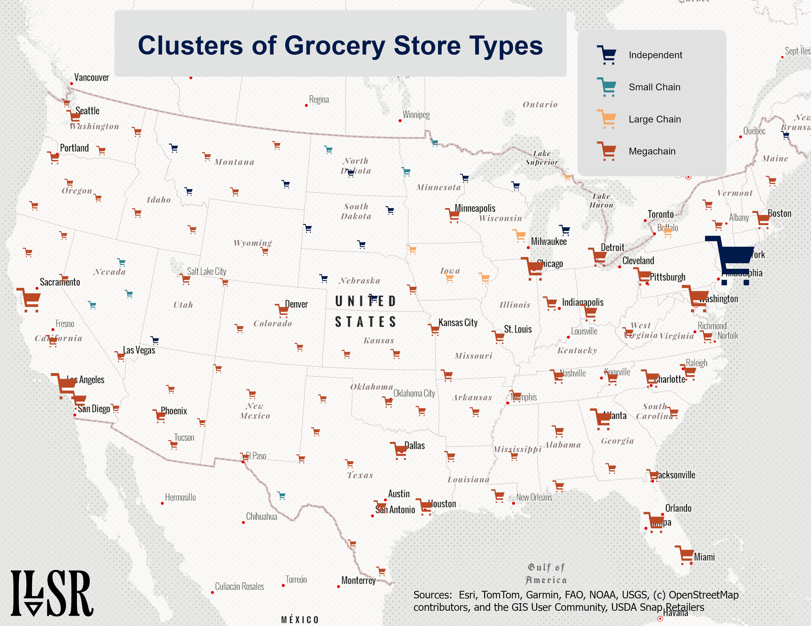

[Back to the calendar](../../index.qmd)

{.post-map}
This map shows clusters of grocery store types across the lower 48 states in the US. The clusters are generated using a 'radius tool', which ranges from low - high (incredibly rigorous method). The clustering for this map was set to low-medium.The store type displayed for each cluster was determined (automatically) by using the most commonly occurring grocery store type within the area. Really, this map is oversimplifying things, and yet the harsh reality is that megachains ARE just that prevalent across the country.